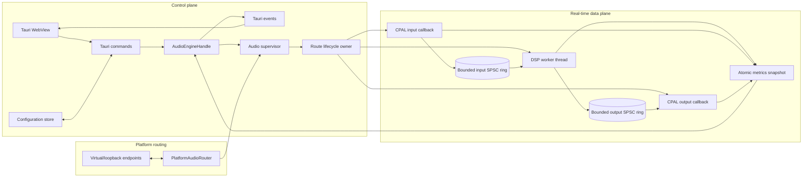
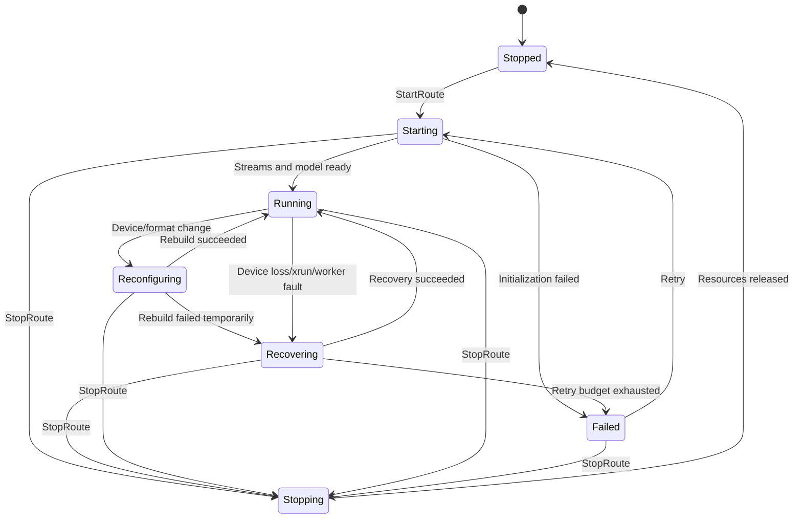

# System Architecture

## 1. Architectural summary

The application is split into a **control plane** and a **real-time data plane**.

- The **control plane** consists of the Tauri UI, Tauri commands/events, configuration persistence, and an `AudioEngineHandle`.
- The **data plane** consists of CPAL streams, bounded sample queues, resampling, frame assembly, DeepFilterNet inference, post-processing, and metrics.

The control plane may be asynchronous and user-driven. The data plane must be deterministic, bounded, and isolated from WebView behavior.

## 2. Component diagram



## 3. Logical components

| Component | Responsibility | Explicit exclusions |
|---|---|---|
| Tauri WebView | Device selection, controls, meters, diagnostics, profiles | PCM processing, audio timing |
| Tauri command layer | Validate DTOs and forward commands | Owning CPAL streams or model state |
| `AudioEngineHandle` | Thread-safe command submission and status reads | Blocking until audio work finishes |
| Audio supervisor | Bounded commands, device refresh, authoritative snapshots, route-owner cancellation | Blocking on route startup/recovery, per-sample DSP |
| Route lifecycle owner | CPAL construction/destruction, activation, cancellable recovery, DSP worker ownership | WebView access, owning model state |
| CPAL adapter | Device discovery, format negotiation, stream construction | DeepFilterNet inference |
| Input callback | Convert samples and enqueue them | Blocking, logging, allocations, inference |
| DSP worker | Resample, map channels, frame model input, infer, post-process | WebView access |
| Output callback | Dequeue and write samples or fallback silence | Waiting on inference |
| DeepFilterNet adapter | Model loading, state, frame processing, reset | Device discovery and UI concerns |
| DSP utilities | Resampling, delay, crossfade, limiter, meters | Application lifecycle |
| Platform router | Virtual endpoints, loopback selection, route safety | Model inference |
| Metrics store | Lock-free or low-contention snapshots | High-frequency UI emission |

## 4. Route model

A **route** is one independently managed audio graph:

```text
Source endpoint
  -> source format conversion
  -> input queue
  -> canonical-rate processing graph
  -> output queue
  -> destination format conversion
  -> destination endpoint
```

Examples:

- `mic-monitor-1`: physical microphone to headphones.
- `virtual-mic-1`: physical microphone to virtual microphone endpoint.
- `incoming-speech-1`: loopback input to physical headphones.

Each route owns:

- CPAL input stream, when applicable.
- CPAL output stream, when applicable.
- Input and output rings.
- One DSP worker thread.
- Independent DeepFilterNet state (one processor per incoming mono/stereo channel).
- Resampler state.
- Delayed dry/bypass state.
- Metrics and fault state.
- A route-specific cancellation signal.

Sharing a physical device across routes may be added later, but the first implementation should favor route isolation over premature graph sharing.

## 5. Data-plane flow

### 5.1 Microphone route

```mermaid
flowchart LR
    A[Physical microphone] --> B[CPAL input callback]
    B --> C[(Input ring)]
    C --> D[Input channel mapping]
    D --> E[Resample to model rate]
    E --> F[Frame assembler]
    F --> G[DeepFilterNet]
    E --> H[Latency-matched dry delay]
    G --> I[Wet/dry crossfade]
    H --> I
    I --> J[Pre-resample non-finite protection]
    J --> K[Resample to output rate]
    K --> SAFETY[Final limiter and output meters]
    SAFETY --> L[Output channel mapping]
    L --> M[(Output ring)]
    M --> N[CPAL output callback]
    N --> O[Headphones or virtual endpoint]
```



### 5.2 Speaker-speech route

The same graph can be reused with a loopback or application-owned source. An explicit processing-mode gate must allow non-speech audio to bypass DeepFilterNet.

## 6. Control-plane flow

### Starting a route

1. The UI sends a validated `StartRoute` request.
2. The Tauri command forwards it to `AudioEngineHandle` through a bounded command channel.
3. The supervisor publishes `Starting` and starts a route-owner thread.
4. The owner resolves the input, allocates bounded transport, and activates input with PCM gated.
5. Output is negotiated after input activation, preserving Bluetooth duplex profile settling.
6. The owner prepares and activates output, keeping it gated while the DSP worker constructs the model.
7. The worker warms the model with quiet non-zero frames, restores pristine temporal state, and reports readiness.
8. After a cancellation check, PCM gates open and stream activation is verified.
9. The supervisor publishes the resulting snapshot before emitting revisioned observations.

The supervisor remains available throughout startup and recovery. CPAL handles are constructed,
used and dropped on the owner; model construction, reset and destruction remain on the DSP worker.
Native calls already in progress cannot be forcibly interrupted. Retry/activation waits check
cancellation in slices of at most 5 ms, and cancelled generations cannot republish `Running`.

### Stopping a route

1. The supervisor publishes `Stopping` and signals the route owner's out-of-band cancellation flag.
2. Callbacks gate capture and render silence; no new processing is enabled after cancellation.
3. The owner leaves any cancellable startup/recovery wait and drops the input stream.
4. The worker is cancelled and joined; model state is destroyed on that worker.
5. The owner releases output and remaining native resources, then publishes `Stopped`.
6. The supervisor retains one terminal snapshot and joins the finished owner.

Application quit performs joins on a background control-plane task while the Tauri event loop
remains alive. Accepted profile writes drain before exit. Current stop uses immediate silence;
an audible fade-out is not claimed by this implementation.

## 7. State machine



## 8. Dependency direction

Dependencies must point inward toward reusable core abstractions:

```text
Tauri desktop
    -> audio-engine
        -> audio-cpal
        -> audio-dsp
        -> denoise-dfn
        -> platform-routing
        -> audio-protocol

All crates -> audio-protocol where shared DTO/domain types are needed
```

Forbidden dependencies:

- `audio-engine` must not depend on Tauri.
- `denoise-dfn` must not depend on CPAL.
- `audio-dsp` must not depend on Tauri, CPAL, or DeepFilterNet.
- CPAL callbacks must not call Tauri APIs.
- Platform-routing implementations must not own model state.

## 9. Error boundaries

Errors are handled at the closest safe boundary:

- **Sample conversion issue:** count and substitute a safe sample if possible.
- **Ring overrun/underrun:** update counters and apply the route policy without blocking.
- **Model frame error:** reset or transition to aligned bypass; notify supervisor.
- **Stream error:** send a compact error message to the supervisor.
- **Device loss:** rebuild or fail the route.
- **Tauri command validation error:** reject before modifying engine state.
- **Worker panic:** detect through thread completion or a panic boundary, mark failed, and release the route.

## 10. Architectural priorities

When tradeoffs arise, apply this order:

1. No crashes, deadlocks, or unbounded latency.
2. Real-time callback safety.
3. Stable audio continuity.
4. Correct routing and lifecycle cleanup.
5. Predictable latency.
6. Noise-reduction quality.
7. CPU efficiency.
8. UI richness.

A temporary aligned bypass is preferable to stalled callbacks or ever-growing queues.

## Phase 6 route concurrency

The supervisor now retains one microphone and one incoming route, each with its own owner and
DSP worker. Incoming stereo keeps independent channel histories; user bypass and microphone
pressure can suspend incoming inference while the aligned dry graph continues. Quit cancels both
owners before joining. Native application sources use bounded Rust rings and never enter IPC.
See [the implementation report](PHASE_6_INCOMING_SPEECH_IMPLEMENTATION_REPORT.md).
