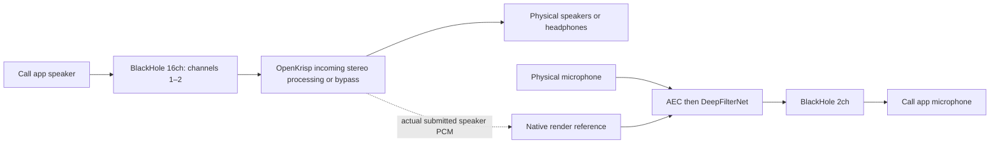

# Separate macOS call audio devices

Historical implementation report for PR #13. The current installer uses
[OpenKrisp-named drivers](VIRTUAL_DEVICE_NAMES.md); the original BlackHole routes below
have been removed from current routing. Validation here applies to the original build.

This change adds the desktop routing prerequisite for simultaneous incoming call
playback and outgoing processed microphone audio. It builds on main `1970ebf`.
It does not qualify speakerphone AEC, a conferencing application, or sustained use.

## Supported graph

The call app must explicitly use BlackHole 2ch as its microphone and BlackHole 16ch
as its stereo speaker, channels 1–2. OpenKrisp uses physical output hardware for the
incoming route. It does not change system defaults, install a driver at runtime,
or start audio automatically. See [installation/setup](INSTALLATION.md).

Two upstream driver variants supply separate buffers. This uses the official
BlackHole 0.7.1 packages, not a renamed device, mirror, aggregate, or custom driver.
Upstream's [installer build](https://github.com/ExistentialAudio/BlackHole/blob/v0.7.1/Installer/create_installer.sh)
assigns separate bundle identities to each channel variant. Its
[driver source](https://github.com/ExistentialAudio/BlackHole/blob/v0.7.1/BlackHole/BlackHole.c)
defines the channel-qualified UIDs and shared buffer between each variant's public
device and optional mirror. Mirrors therefore cannot serve as a second independent bus.

## Routing and recovery

| Role | Logical endpoint | Native UID | Selected PCM |
| --- | --- | --- | --- |
| Outgoing microphone | `macos:blackhole-2ch` | `coreaudio:BlackHole2ch_UID` | Stereo output |
| Incoming call | `macos:blackhole-16ch` | `coreaudio:BlackHole16ch_UID` | Native channels 1–2 |
| Existing incoming-only profiles | `macos:blackhole-2ch` | `coreaudio:BlackHole2ch_UID` | Stereo input; cannot run with the 2ch virtual microphone |

Discovery requires a unique exact UID, CoreAudio host, virtual transport, duplex
roles, and the expected native channel count on both sides (2 or 16). Display names
and default-device flags do not affect identity. Incoming discovery lists 16ch first,
including when missing, and retains the old 2ch option without rewriting profiles.
The microphone destination remains 2ch; arbitrary multichannel routes are unsupported.

Each mirror maps to its own variant's canonical ancestry. The same logical bus is
still rejected for concurrent capture/microphone output in either start order.
Known BlackHole public/mirror UIDs cannot be used as physical incoming destinations
or physical microphone sources, even if transport metadata is misclassified.
Aggregate, unknown, duplicate, missing, and changed-width endpoints fail closed.

The owner revalidates the logical route and channel selection before each generation.
Removing 16ch cannot redirect incoming capture to the outgoing 2ch microphone bus.
The existing independent owners, Stop/restart behavior, bounded recovery, microphone
priority, and worker-confined DeepFilterNet/AEC state remain in place.

## Native capture boundary

Platform preparation returns a native-only `capture_stereo_channels: Some(16)` for
the verified incoming 16ch endpoint. The owner negotiates an exact 16-channel CPAL
input, then the callback copies channels 1–2 to the existing stereo PCM path.
Channels 3–16 are discarded, never mixed into left/right. An incompatible native
width fails negotiation. The low-level selection API permits explicit widths 3–16;
production routing selects only the verified 16ch bus. Ordinary input/output
negotiation still accepts only mono/stereo, and a selected-input configuration is
rejected by the output builder.

`NegotiatedStreamConfig::stream_config()` describes native hardware (16 channels);
`protocol()` and the route's `inputFormat` describe delivered PCM (2 channels).
The inventory retains the native default format. Rates and requested/observed device
buffer sizes are unchanged. Scratch space is allocated before streaming and holds
at most 2,048 stereo frames (16 KiB). Larger callbacks use bounded chunks; malformed
partial native frames record a callback violation and invalidate the observation tap.
The tested conversion path performs no allocation, mutex wait, inference, I/O or logging.

Callback counts, timestamp frame positions, and chunk offsets count native **frames**,
not samples. Each selected stereo frame has the same capture instant as its 16-channel
source frame. Existing per-stream clock domains, monotonic nanosecond estimates,
alignment/drift behavior, 64-block/200 ms observation bounds and generation invalidation
remain unchanged. Capture taps carry selected stereo; the AEC reference still comes
after incoming processing, resampling and device conversion at the physical output.
Delay remains estimated, not measured end-to-end latency. No PCM or channel mapping
is added to Tauri IPC or saved profile schemas.

## Installer

The combined package now contains independently selected BlackHole 2ch and 16ch
components. Both downloads are hash pinned in `packaging/macos/blackhole.json` and
repacked without modifying payloads/scripts. The 16ch hash is
`57254e2f76cd40db7f3f715238b1a2cb2bd08819d38abf4087f2944f71a3641a`, matching the
[Homebrew cask](https://github.com/Homebrew/homebrew-cask/blob/master/Casks/b/blackhole-16ch.rb).
macOS signature and notarization assessment accepted that official package.

Each driver choice checks its own installed bundle identity/version, repairs a
missing/older variant, and preserves a same-or-newer variant. Either installation
requires a restart. Upstream postinstall scripts normalize permissions on all
`BlackHole*ch.driver` bundles, including existing variants. They do not delete the
other variant. Matching source/license/provenance remain bundled once for both.
OpenKrisp has since selected PolyForm Perimeter. Separate BlackHole permission and
release signing remain unresolved; see the current [licensing status](LICENSING.md).

## Validation and limitations

Final local macOS validation passed:

| Check | Result |
| --- | --- |
| `cargo ci-test --locked` | 222 passed; two existing opt-in timing benchmarks ignored |
| Workspace Clippy, all targets/features, `--locked`, warnings denied | Passed |
| Engine Clippy without default features, all targets, warnings denied | Passed |
| `cargo ci-fmt` and `git diff --check` | Passed |
| `npm run --prefix apps/desktop test` | 51 passed |
| Production frontend build | Passed |
| Python installer/native source tests | 11 passed |
| Tauri release `.app` build | Passed |
| Combined development `.pkg` build and content verification | Passed, both drivers present |
| macOS Installer read-only choice evaluation | App selected; installed 2ch 0.7.1 preserved; missing 16ch selected |

Artifacts: `target/release/bundle/macos/OpenKrisp.app` and
`target/release/bundle/pkg/OpenKrisp-dual-audio-dev.pkg`. The outer package is unsigned
for local development; release distribution requirements are unchanged. Logs and
source/artifact hashes are indexed in [the evidence manifest](evidence/macos-dual-audio-devices-validation.json).
Remote CI has not been run for this feature branch.

Deterministic coverage includes channel content/order, quantized inputs, oversized callback chunks,
native-frame timestamp alignment and zero allocations; strict discovery, both start
orders, independent Stop/restart and missing-device revalidation; saved-bus retention,
missing setup and same-bus UI guards; and all mixed driver install/upgrade choices.

The development Mac currently has BlackHole 2ch but not 16ch. No driver was installed,
no system audio settings were changed, and no new microphone recording or live call
was made for this implementation. The built app/installer must be installed and the
two-bus graph tested on real devices before claiming acoustic or conferencing success.
E14-06, E16-05/E16-06, Phase 6's two-hour concurrent hardware runs, device recovery,
Bluetooth profile transitions and broader hardware compatibility remain open.
